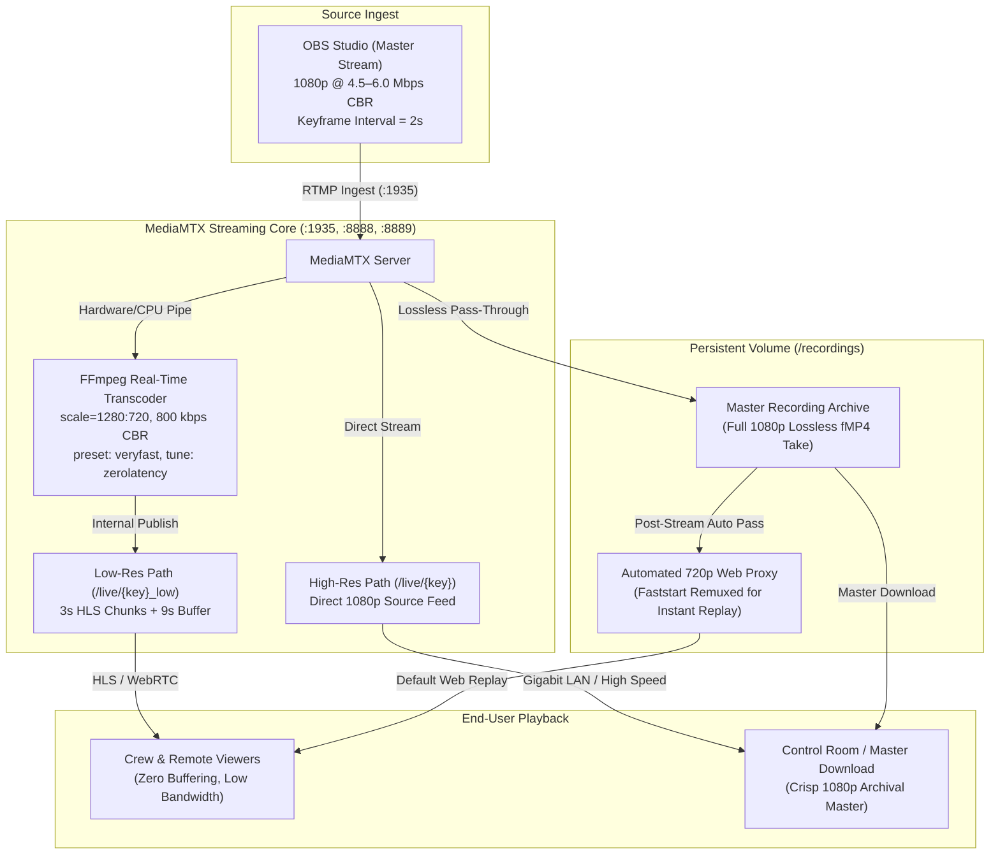

# High-Quality Post-Show Recording & Lightweight Streaming Architecture

## 1. Goal Overview

To satisfy two distinct requirements simultaneously:

1. **High-Quality Master Recordings:** OBS streams a sharp, high-bitrate video stream (1080p, 4.5–6.0 Mbps) that is recorded directly to persistent storage in uncompressed segmented fMP4 format for long-term archiving, post-production, or official master downloads.
2. **Buffer-Free, Low-Bandwidth Live & Replay Streaming:** Viewers on residential connections, mobile devices (4G/5G), and remote crew networks receive a lightweight, hardware-efficient 720p @ 800 kbps rendition that plays smoothly with zero stutter and minimal latency.

---

## 2. Dual-Tier Streaming Topology



### ASCII Flow Architecture

```text
┌──────────────────────────────┐              ┌────────────────────────────────────────────────────────┐
│  OBS Studio (Master Stream)  │              │                 MediaMTX Server Engine                 │
│                              │              │                                                        │
│   1080p @ 4.5–6.0 Mbps CBR   ├─RTMP :1935──►│  1. Ingest Pass-Through -> Direct to Disk (/recordings) │
│   Keyframe Interval = 2s     │              │  2. Direct Source Path  -> /live/{key}                 │
│                              │              │  3. FFmpeg Pipe Transcode -> /live/{key}_low           │
└──────────────────────────────┘              └──────────────┬─────────────────────────┬───────────────┘
                                                             │                         │
                             ┌───────────────────────────────┘                         └───────────────────────────────┐
                             │ Direct Pass-Through                                                                     │ Real-Time Transcode (scale=1280:720, 800k)
                             ▼                                                                                         ▼
              ┌─────────────────────────────┐                                                           ┌─────────────────────────────┐
              │  Master Recording Archive   │                                                           │ Low-Res Live Rendition      │
              │  (/recordings/live/{key}/)  │                                                           │ (/live/{key}_low)           │
              │  Full 1080p fMP4 Master     │                                                           │ 720p @ 800 kbps, 60fps      │
              └──────────────┬──────────────┘                                                           └──────────────┬──────────────┘
                             │ Post-Stream Processing Pass                                                             │ 3s HLS Chunks + 9s Buffer
                             ▼                                                                                         ▼
              ┌─────────────────────────────┐                                                           ┌─────────────────────────────┐
              │ Faststart Web Replay Proxy  │                                                           │ Crew & Remote Viewers       │
              │ (720p Optimized .mp4)       ├─────────────────Instant Replay Streaming─────────────────►│ (Zero Stutter, Low Bandwidth)│
              └─────────────────────────────┘                                                           └─────────────────────────────┘
```

---

## 3. Recommended OBS Studio Settings

To ensure crystal-clear archival video while maintaining rock-solid network stability:

### Video Tab:
* **Base (Canvas) Resolution:** `1920x1080`
* **Output (Scaled) Resolution:** `1920x1080` (identical to canvas; do not downscale in OBS)
* **Downscale Filter:** `Lanczos (Sharpened scaling, 36 samples)`
* **Common FPS Values:** `30` or `60` fps (`30` fps is recommended for stage/theater events to maximize per-frame visual clarity and bitrate budget).

### Output Tab (Streaming):
* **Output Mode:** `Advanced`
* **Encoder:** `NVIDIA NVENC H.264` (or `Apple VT H.264` / `Intel QuickSync H.264` / `x264`)
* **Rate Control:** `CBR` (Constant Bitrate)
* **Bitrate:** `4500 Kbps` to `5000 Kbps` (Ideal balance for crisp 1080p stage footage without overflowing upload connections).
* **Keyframe Interval:** `2 seconds` (**CRITICAL:** Required for clean HLS 3s segment alignment, instant seeking, and WebRTC keyframe sync).
* **Preset:** `P5: Slow (Good Quality)` or `P6: Slower (Better Quality)`
* **Tuning:** `Low Latency` or `High Quality`
* **Multipass Mode:** `Two Passes (Quarter Resolution)`
* **Profile:** `High`
* **Max B-frames:** `2`

---

## 4. System Adjustments Implemented in StageControl

### 1. MediaMTX Real-Time Transcoder Pipeline
MediaMTX automatically captures the 5 Mbps 1080p OBS master stream and produces a lightweight live rendition in real-time without writing intermediate chunks to disk:

```yaml
# services/mediamtx/mediamtx.yml
~^live/(?P<key>[^/]+)$:
  source: publisher
  record: yes
  recordPath: /recordings/%path/%Y-%m-%d_%H-%M-%S-%f
  recordFormat: fmp4
  recordPartDuration: 1s
  recordSegmentDuration: 1h
  recordDeleteAfter: 0s  # Explicitly prevents deletion of all live takes

  runOnAvailable: >
    ffmpeg -hide_banner -loglevel warning
    -i rtmp://localhost:1935/live/$key
    -vf "scale=1280:720"
    -c:v libx264 -preset veryfast -tune zerolatency
    -b:v 800k -maxrate 950k -bufsize 1600k
    -g 60 -keyint_min 60 -sc_threshold 0
    -c:a aac -b:a 64k -ar 44100
    -f flv rtmp://localhost:1935/live/${key}_low
  runOnAvailableRestart: yes
```

### 2. HLS Segment Duration & Buffering Optimization
* `hlsSegmentDuration` is set to `2s`–`3s` with `hlsSegmentCount: 20`.
* A 6–9 second initial buffer absorbs residential internet jitter and transient 4G/5G packet loss while preserving near-instant playback initiation.

### 3. Route Synchronization in FastAPI & Web Reverse Proxy
* In `apps/api/app/routers/streams.py`, `hls_low_playlist_url` routes directly to `/live/{stream_key}_low/index.m3u8`.
* Next.js and reverse proxies forward `/live/*` directly to MediaMTX.
* In the live viewer player, crew members and viewers can seamlessly toggle between:
  * **Auto / Low (720p @ 800 kbps):** Zero-stutter, hardware-accelerated playback on any connection.
  * **Source (1080p @ 5000 kbps):** Full-quality direct broadcast feed for high-speed local control rooms.

### 4. Automated 720p Faststart Web Proxy for Recording Replays
* When a stream segment completes (`runOnRecordSegmentComplete` / `runOnOffline`), FastAPI triggers the background post-processing job:
  1. Faststart remuxing (`-movflags +faststart`) so playback can seek and start instantaneously without downloading the entire file.
  2. Creates a lightweight 720p @ 800 kbps proxy file.
* When streaming replays via `/api/events/.../recordings/{id}/stream`, the backend automatically serves the faststart 720p proxy by default for fast, stutter-free scrubber performance.
* If a director or stage manager clicks **Download Master** or specifies `quality=source`, the raw full-resolution 1080p master recording is delivered.
