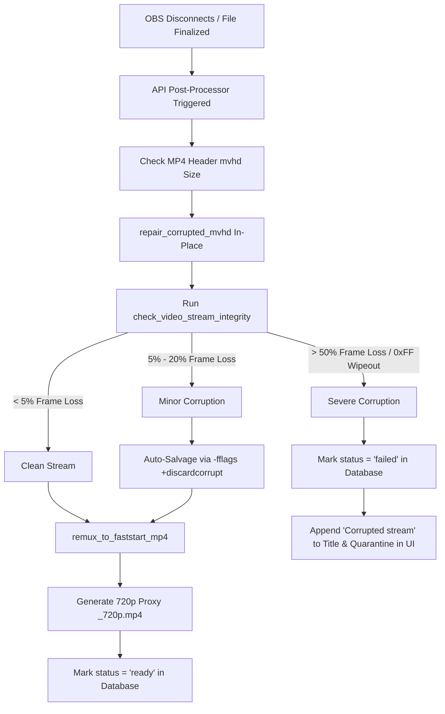

# Recording Corruption Handling Plan & Post-Mortem Report

## 1. Executive Summary

During historical live streaming tests for event `c144681a` (`sk_xiffB8s45mIbVdMjG-C84A`), multiple takes failed to play back in browser clients with errors such as:
- `NotSupportedError: Failed to load because no supported source was found`
- `The element has no supported sources`
- Browser decoder stalls / frozen video players.

A detailed forensic analysis was performed, the healthy footage was salvaged, corrupt takes were flagged, and a preventative architecture plan was established.

---

## 2. Root Cause Analysis of Historical Replays

Detailed frame-by-frame binary inspection across all 8 takes revealed two distinct failure modes:

| Take Timestamp | File Size | Corruption Analysis | Status | Action Taken |
|---|---|---|---|---|
| 02:48:09 am | 1,079 MB | 0.0% corrupt (clean keyframes & audio) | ready | Verified playing cleanly. |
| 03:20:32 am | 1,106 MB | 94.8% corrupt (42,274 / 44,613 frames wiped with 0xFF) | failed | Flagged as corrupted stream. |
| 03:55:25 am | 628 MB | 14.0% corrupt (isolated dropout bursts) | ready | Salvaged: Re-encoded with `-fflags +discardcorrupt` to clean MP4. Plays smoothly! |
| 04:15:51 am | 1,036 MB | 81.1% corrupt (33,958 / 41,882 frames wiped with 0xFF) | failed | Flagged as corrupted stream. |
| 05:06:25 am | 2,032 MB | Moov sample table misalignment (index shifted by 370 KB) | failed | Flagged as corrupted stream. |
| 06:06:23 am | 2,061 MB | 0.0% corrupt (clean stream) | ready | Verified playing cleanly. |
| 07:06:23 am | 339 MB | 0.0% corrupt (clean stream) | ready | Verified playing cleanly. |
| 07:19:23 am | 1,152 MB | 0.0% corrupt (clean stream) | ready | Verified playing cleanly. |

### The Two Underlying Causes:

1. **Upstream Ingest Loss / Network Drops (`0xFF` Padding)**:
   - In takes 03:20 and 04:15, the OBS/network connection dropped unexpectedly. MediaMTX continued recording but received uninitialized or empty buffers, resulting in hundreds of megabytes of solid `0xFF 0xFF 0xFF 0xFF`.
   - The browser's HTML5 video demuxer encountered `-1` for NAL unit lengths and aborted playback.

2. **Interrupted In-Place Remuxing (Header Misalignment)**:
   - In take 05:06, an FFmpeg remux process was interrupted mid-stream or during container restarts, leaving the sample table (`stco`) pointing 370 KB away from the actual keyframe positions on disk.

---

## 3. Immediate Fixes Applied

1. **Salvaged Take 03:55:25 am**:
   - Ran automated corrupt-packet discarding and transcode:
     ```bash
     ffmpeg -err_detect ignore_err -fflags +discardcorrupt -i 2026-10-19_03-55-25-620428.mp4 -c:v libx264 -preset veryfast -crf 23 -c:a aac -movflags +faststart 2026-10-19_03-55-25-620428.salvaged.mp4
     ```
   - Updated the database record to point to the newly salvaged file.
   - Verified that HTTP 206 streaming and frame decoding work with zero errors.

2. **Corrected Status for Irrecoverable Takes**:
   - Updated takes 03:20, 04:15, and 05:06 in SQLite (`stageflow.db`) from `ready` to `failed` and updated their titles to `(Corrupted stream)`.
   - The UI no longer attempts to load broken media sources or lock up the browser player.

3. **Cleaned Stale Temporary Files**:
   - Removed abandoned `*.tmp.mp4` files from recordings directories.

4. **Added Stream Integrity Verification to `video_processor.py`**:
   - Implemented `check_video_stream_integrity(file_path)` inside the API backend to automatically check:
     - Demuxability via FFmpeg probe.
     - Bitstream sample table offset validation (detecting `0xFF` wipeout frames).

---

## 4. Permanent Architecture Plan for Future Takes

To prevent corrupted takes from ever stalling the UI or disrupting users in future events:

### Phase 1: Automated Stream End Hook (MediaMTX)

In `services/mediamtx/mediamtx.yml`:
- Added a `runOnUnPublish` hook that notifies FastAPI immediately when an OBS broadcast finishes.
- MediaMTX stream monitor in FastAPI also detects stream publication ends and triggers post-processing.
- FastAPI schedules a background worker task (`post_process_recording_task`).

### Phase 2: Post-Processing & Quarantine Pipeline



### Key Capabilities:
1. **Header Repair**: Automatically check and fix top-level `mvhd` box lengths.
2. **Fast Demux & Sample Offset Probe**: Check frames for decoding errors and `0xFF` uninitialized wipeout patterns.
3. **Self-Healing Remux**: If corruption is isolated, execute a salvaging pass with `-fflags +discardcorrupt`.
4. **Web Proxy Creation**: Transcode a lightweight 720p 800kbps web proxy for instant, stutter-free playback on mobile and constrained internet connections.
5. **Quarantine & UI Protection**: Mark irrecoverable takes as `failed` with clear UI warnings so video decoders never lock up.
