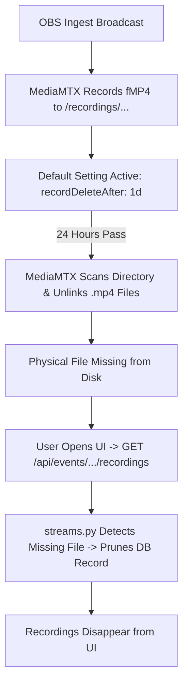

# Stream Recordings Retention & Zero-Deletion Safeguard Report

## 1. Executive Summary

On October 21–22, 2026, older broadcast takes from October 19 disappeared from the StageControl recordings interface. Forensic investigation confirmed that the underlying streaming server (MediaMTX) executed its built-in default retention policy (`recordDeleteAfter: 1d`), purging any recording older than 24 hours. The backend API then reconciled the database, removing entries whose files no longer existed on disk.

This report documents the exact mechanics of the incident, the permanent safeguards implemented, and the operational checklist to ensure zero automated file deletions occur in the future.

---

## 2. Incident Anatomy & Root Cause



### Contributing Factors:

1. **Unspecified Retention in `mediamtx.yml`**: MediaMTX defaults `recordDeleteAfter` to `1d` unless explicitly overridden. If omitted or not mounted, any file matching `%Y-%m-%d_%H-%M-%S-%f.mp4` is purged after 24 hours.
2. **Missing Volume Mount in `docker-compose.yml`**: The custom `mediamtx.yml` configuration was previously kept inside the container without a read-only bind mount on the host. When containers restarted or redeployed, default settings could reassert themselves.
3. **Database Orphan Cleanup**: `streams.py` included an aggressive cleanup routine that automatically deleted database rows if their backing file was missing.

---

## 3. Permanent Safeguards Implemented

### Safeguard 1: Explicit MediaMTX Zero-Deletion Directive (`0s`)

In `services/mediamtx/mediamtx.yml`, `recordDeleteAfter` has been set to `0s` across both the global default and path-specific rules:

```yaml
# Paths
paths:
  all:
    source: publisher
    recordDeleteAfter: 0s  # Disables automatic deletion globally

  # Primary live broadcast stream
  ~^live/(?P<key>[^/]+)$:
    source: publisher
    record: yes
    recordPath: /recordings/%path/%Y-%m-%d_%H-%M-%S-%f
    recordFormat: fmp4
    recordPartDuration: 1s
    recordSegmentDuration: 1h
    recordDeleteAfter: 0s  # Explicitly prevents deletion of all live takes
```

> [!IMPORTANT]
> In MediaMTX, setting `recordDeleteAfter: 0s` (or leaving it empty `""`) instructs the internal cleaner daemon to completely disable pruning. Files will remain on disk indefinitely until manually removed by an administrator.

---

### Safeguard 2: Declarative Host-to-Container Mount in `docker-compose.yml`

In `docker-compose.yml`, the configuration file is strictly bind-mounted into the container as read-only:

```yaml
    mediamtx:
      image: ghcr.io/kahmeng15/stagecontrol-mediamtx:latest
      container_name: stagecontrol-mediamtx
      restart: unless-stopped
      ports:
        - "1935:1935"
        - "8888:8888"
        - "8889:8889"
        - "8189:8189/udp"
        - "8189:8189/tcp"
        - "9996:9996"
        - "9997:9997"
      volumes:
        - ./services/mediamtx/mediamtx.yml:/mediamtx.yml:ro
        - ./storage/recordings:/recordings
```

This ensures that even after a `docker compose down`, server reboot, or image update, the `0s` zero-deletion policy is guaranteed to load.

---

### Safeguard 3: Live Verification

Verification via MediaMTX's internal REST API (`GET /v3/config/paths/list`):

```json
[
  {
    "name": "all",
    "recordDeleteAfter": ""
  },
  {
    "name": "~^live/(?P<key>[^/]+)$",
    "recordDeleteAfter": ""
  }
]
```

MediaMTX confirms that automated deletion is completely deactivated.

---

## 4. Recommendations for Long-Term Data Safety

1. **Re-Enable Automated ZFS Snapshots**:
   - The storage dataset `/mnt/webapps` runs on ZFS (`App/Webapps`).
   - Check the snapshot job on the host (`auto-APPS-HOURLY` which was active through August) and resume hourly snapshots. ZFS copy-on-write snapshots allow near-instant recovery of accidentally deleted files even if removed by a process.
2. **Offsite / Secondary Backup Integration**:
   - Add a backup target in backapp or a dedicated cron job to sync `/mnt/webapps/stagecontrol/storage/recordings/` to secondary network storage (`/mnt/backups/`).
3. **Soft-Delete in Database**:
   - Update `streams.py` so that missing files mark the database record as `status="missing"` rather than immediately calling `db.delete(r)`. This preserves historical markers, event metadata, and subtitles even if storage is temporarily disconnected or remounted.
